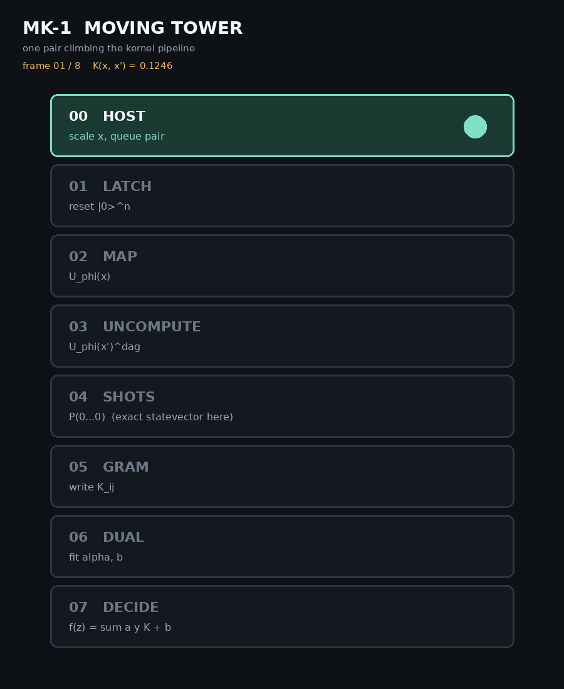

# MK-1 quantum kernel

[](https://github.com/BenFrohman/mk1-quantum-kernel/actions/workflows/ci.yml)
[](LICENSE)

MK-1 is a small, exact (statevector) simulation of a **2-qubit ZZ-feature-map fidelity kernel**
estimated by compute-uncompute,
`K(x, x') = |<00| U(x')† U(x) |00>|²`, plus an animated "moving tower" view of the kernel-SVM pipeline.



It is a known construction (Havlíček et al., *Nature* 567, 2019), packaged with tests, a Lean 4 check of
the kernel's basic properties, and a short technical note. It makes no claim of quantum advantage.

## Use

```bash
pip install git+https://github.com/BenFrohman/mk1-quantum-kernel
mk1 --out artifacts/mk1          # writes mk1-tower.gif and gram.npy
```

```python
from mk1 import kernel, gram
kernel([0.3, -1.2], [0.5, 0.1])
```

## Variants

* `zz` (default): the entangling gate `CNOT · (I⊗RZ(2·x0·x1)) · CNOT = exp(-i x0x1 Z⊗Z)`.
* `legacy`: the original script ([`original/mk1_moving_tower.py`](original/mk1_moving_tower.py)) put that RZ on the
  CNOT *control* qubit. It commutes with CNOT, so the CNOTs cancel and the kernel factorises as
  `cos²(Δ0 + Δ01)·cos²(Δ1)`. Kept for reproducibility.

## What is checked

**Python tests** (`tests/`): unitarity; `K(x,x)=1`; symmetry; `0 ≤ K ≤ 1`; compute-uncompute equals state overlap;
agreement with an independent matrix-free closed form; Gram matrices PSD; the CNOT identities.

**Lean 4 + Mathlib** (`lean/MK1/FidelityKernel.lean`, sorry-free, audited to `propext`, `Classical.choice`, `Quot.sound`):
for any family of unit states / any unitary feature map, `K(x,x)=1`, symmetry, `0 ≤ K ≤ 1`, compute-uncompute = fidelity,
and the Gram matrix is positive semidefinite; plus the two CNOT identities above.

## Paper

[`paper/mk1.pdf`](paper/mk1.pdf): *MK-1: an exactly simulated two-qubit ZZ-feature-map fidelity kernel, with machine-checked kernel properties.*

## License

Apache-2.0. Copyright 2026 Benjamin Stanley Frohman (see [NOTICE](NOTICE)). The paper text is CC BY 4.0.

## Citation

Cite this work with [`CITATION.cff`](CITATION.cff) (GitHub's "Cite this repository" button).
